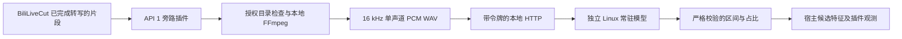

# 架构、接口与失败处理



## 为什么采用独立服务

宿主插件使用标准库客户端，不导入 TensorFlow，也不修改宿主 Python、模型池或 CUDA 环境。重型依赖只安装到独立运行环境。宿主插件不启动子服务或安装脚本，启用时只保存公共上下文，首次调用读取设置。

独立服务常驻一个 `inaSpeechSegmenter.Segmenter`，固定 `smn`、`detect_gender=False` 和 `ffmpeg=None`。服务不解码压缩媒体，FFmpeg 留在宿主侧，因此不需要给服务挂载录制目录。

为了禁止模型路径隐式联网，服务只在自己进程内替换上游模型定位函数为固定清单校验器。CNN、特征提取、Viterbi 和官方发行包源码均未改写；这不是在宿主进程中修改第三方全局状态。

现有 API 只有直播源和高光评分两类能力。本插件使用真实存在的高光契约，明确占用一个评分槽位；没有虚构一个尚不存在的转写前接口。未来若宿主正式提供音频分析契约，迁移需要新一轮接口和回归验收。

## HTTP 协议 v1

每个请求须有 `Authorization: Bearer <64位服务令牌>`。不接受 Origin 请求，不返回 CORS 许可，不跟随重定向。客户端使用独立连接，不读取系统 HTTP 代理；HTTPS 使用系统证书校验。

### GET /v1/health

鉴权成功且模型加载完成后返回：

```json
{"ready":true,"schema_version":"1","model_sha256":"f04b5e3c86fa2e81666d106b0867350fe7858c7bd006c2a74c27b5b45507e7d8"}
```

客户端校验字段集合、就绪状态、协议及模型身份。HTTP 200 本身不等于就绪。

### POST /v1/analyze

`Content-Type` 必须是 `audio/wav`，只能有一个 `Content-Length`，不接受 Transfer-Encoding。请求体上限 19,201,024 字节，必须为完整的 16 kHz、单声道、16-bit PCM WAV，实际时长 0.72–600 秒。上传总时限为 10 秒。

请求不接受媒体 URL、本机路径、模型名、shell 命令或 TensorFlow 参数。推理选项只能由服务管理员在启动时配置。

响应包含 `schema_version`、`engine`、`engine_version`、`duration_s`、`segments`、`model_sha256`、`inference_s`、`cache_hit`，完整例子见 [真实模型响应](evidence/analysis-example.json) 和 [运行配置](CONFIGURATION.md)。每个 segment 仅有 `label/start_s/end_s`。

客户端拒绝多余字段、重复 JSON 键、NaN/Infinity、未知标签、错误模型、区间重叠/缺口和时长不符。响应总上限 2 MB，区间数不超过 30,001。

| 状态码 | 含义 |
| --- | --- |
| 200 | 已验证的就绪状态或分类结果 |
| 400 | 长度字段或请求边界非法 |
| 401 | 鉴权失败、重复认证头或带 Origin |
| 404 | 未登记路由，包括带查询参数的路径 |
| 408 | 请求体上传超过总时限 |
| 413 | 请求体大小不在允许范围 |
| 415 | 非 WAV Content-Type |
| 422 | WAV 或模型输出未通过校验 |
| 503 | 推理资源暂时不可用 |

HTTP 服务只面向本机或受信任专用网络，不作为公共互联网接口。单调用者架构避免多份模型并行抢占资源，不能作为公开多租户任务调度器。

## 恢复、幂等和隐私

相同 WAV 内容得到相同缓存身份；文件名、mtime、宿主 ID 不作为缓存键。缓存仅存在内存，有数量上限，不保存原音频、转写或弹幕。

插件失败时抛出明确异常，由宿主公共调度器记录回退；不吞掉失败、不将未知比例填为 0、不修改主程序数据库。没有隐式重试或第二套后台任务，避免一个失败请求成倍占用算力。

宿主解码和服务推理的临时目录在正常成功、异常和正常停止时释放。SIGKILL、断电或系统崩溃不能保证清理，见 [安装与排错](INSTALLATION.md)。

服务错误响应不回显异常、来源路径或媒体内容；服务不记录请求行及认证头。内部推理资源故障的异常链只保留在受保护的服务日志中，用于定位权限、模型或资源问题，不应直接公开日志。模型安装步骤是显式网络操作，只允许官方 HTTPS 模型资产和登记的 GitHub 资产重定向，模型必须匹配固定大小及 SHA-256。
